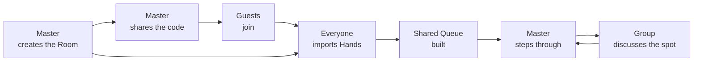

# Runout — Functional spec and epics

2026-09-19 · @Someone

Domain terms (Account, Room, Master, Guest, Hand, Hero, Author, Library, Room Hand, Queue, Playback, Action, Street, Result…) are defined in [CONTEXT.md](CONTEXT.md) and used here with exactly that meaning. Decisions that shape the model are in [docs/adr/](docs/adr/).

## Product summary

Runout is a web Room where several players review the same poker Hand at once, synchronised in real time. The Master steps through the Hand Action by Action and everyone else sees exactly the same table on their own screen.

It is also where each player keeps their own Hands. Their Library holds the Hands they import into it, and its Results Graph shows whether they are winning. The aim is that the Tracker stops being the only place their history lives (ADR 0004).

It solves the problem of a group that already meets every week and today shares a screen over Discord or Zoom. That format turns one person into the operator and everyone else into spectators: nobody else can point, go back or bring their own Hands without breaking the session. The picture also arrives compressed, and reading a stack in big blinds off a rescaled video is harder than it looks.

The target user is a study group of three to eight online cash players who already use a Tracker (PokerTracker 4, Hold'em Manager 3 or Hand2Note) and export text Hand Histories. It is not a solver: it computes no strategy. In a Room it organises the conversation the group already has, and in the Library it keeps and measures each player's Hands.

The difference from screen sharing is that the Hand History is data, not pixels: each Participant sees it rendered on their own screen, with their own deck and Display Unit, and the Queue is built by the whole group instead of one person.

The study group itself lives outside Runout. There are no groups or teams inside the app: only Rooms, shared with the group through whatever chat it already uses.

## Participants, roles and identity

There are two roles, and the difference between them is a single thing: who controls Playback. In everything else — bringing Hands, writing Notes, configuring their own view — Master and Guest are equal. Separately, a Participant is either signed in with their Account or anonymous. That decides what outlives the Room, and whether they can create a Room or add Hands from a Library.

| Capability | Master | Guest |
| --- | --- | --- |
| Create the Room and name it | Yes (as its creator, with an Account) | — |
| Share the Room Code and link | Yes | Yes |
| Import Hands into the Queue | Yes | Yes |
| Add Hands from their own Library to the Queue | Yes, with an Account | Yes, with an Account |
| Choose which Hand is loaded | Yes | No |
| Step Actions and jump Streets | Yes | No |
| Toggle Hide Opponent Names | Yes | No |
| See the synchronised table live | Yes | Yes |
| Write Notes on a Hand | Yes | Yes |
| Edit or delete Notes in the Room | Yes | No |
| Reorder and remove Queue Entries | Yes | No |
| Reassign the Author of a Queue Entry | Yes | No |
| Choose their own deck, Display Unit and language | Yes | Yes |
| Hand the Master role to another Participant | Yes | No |
| Kick a Participant and close the Room | Yes | No |

The Master role is born with the Room: whoever creates it holds it. It is never requested, only handed over. The Master can hand it to any Participant at any time; the handover is immediate, visible to everyone, and does not touch Playback. A Master cannot simply leave: leaving means handing the role over or closing the Room.

If the Master loses connection for more than two minutes, the role passes automatically to the Participant who has been present the longest, so the session never gets stuck. When the former Master comes back they join as a Guest; if they want the role back they ask for it out loud.

What lasts belongs to an Account, signed in with Google: the Library, Screen Names, Display Name, Preferences, Marks and Tags. The Account is recognised on any device where that person signs in (ADR 0005). Creating a Room needs an Account, so every Room starts with a lasting Master.

Joining a Room needs none. A person who doesn't sign in gets an anonymous identity that exists for that one Room. They can import Hands, write Notes and even become Master, but their identity, Screen Names, Preferences and Marks are lost when the Room closes. Notes they wrote keep their Display Name. If they sign in while inside the Room, their Account takes the anonymous identity's place, keeping the Master role if they held it.

## End-to-end flow

The full journey has six stages, from creating the Room to discussing a specific spot. The point of no return is the fourth: until the Queue has Hands, the Room is empty and there is nothing to review.

The loop between stepping and discussing is where most of the session goes: stop, discuss, go back, step forward again, dozens of times per Hand. Playback only moves when the Master moves it; there is no automatic play, because the conversation sets the pace.

1. **The Master creates the Room.** Signed in with their Account, they give the Room a name on the **Salas** screen. The Room exists from that moment, even while empty.
2. **They share access.** The system generates an eight-character Room Code and a copyable link. The Master pastes it into the group's chat.
3. **Guests join.** With the link they open the Room; with the code they type it. Signed in, they go straight in under their Display Name; otherwise they continue with Google or enter without an Account under a Display Name for that Room. No registration.
4. **Everyone brings Hands.** Each person uploads their Tracker export, pastes Hand History text, or adds Hands from their own Library. Each Queue Entry gets its Author.
5. **The Master drives Playback.** They load a Hand from the Queue and step through it Action by Action or jump between Streets.
6. **The group discusses.** Everyone sees the same state at the same moment; they stop at the decision point, talk over voice, and the conclusion is left as a Note on the Hand.

Voice still goes through Discord or wherever the group already talks. Runout carries no audio in this version, on purpose: the group has that solved.

## Epic map

Nine epics cover the product. Five are essential for a session to work end to end. Notes and preferences could land partially and grow later. The Library and Results epic is the second release, which turns Runout into where each person keeps their Hands. The Lab comes after it, as a place to study preflop Ranges away from any Hand.

| Epic | Goal | Priority |
| --- | --- | --- |
| E1 · Rooms | Create a Room, share it, join it with a code or a link, and run its lifecycle | MVP |
| E2 · Hand import | Turn Hand Histories into playable Hands with their Hero, into a Room or a Library | MVP |
| E3 · Shared Queue | One list of Hands with their metadata, built by everyone | MVP |
| E4 · Player | Step through a Hand on a readable table | MVP |
| E5 · Synchronisation | Everyone sees the same Playback at the same instant | MVP |
| E6 · Notes and Marks | Record the group's conclusion on a Hand and flag Hands to find again | Partial in MVP |
| E7 · Library and Results | Keep, find, classify and measure your own Hands, and bring them to a Room | Second release |
| E8 · Accounts and preferences | Sign in, read the table your own way, and be recognised in Hand Histories | Partial in MVP |
| E9 · Lab | Build, measure, name and find your own preflop Ranges | After the second release |

Build order is not the table order. E2 goes first because without parsed Hands there is nothing to show, and E4 can be built locally long before E5 exists.

## E1 · Rooms

A Room holds exactly one study session: its Participants, a Queue and the Playback. It closes when its Master closes it, or on its own after 30 minutes with nobody connected. A closed Room never reopens, and closing it either way discards its Room Hands and its anonymous identities.

**H1.1 — Create a Room.** As the player organising the session, I want to create a Room with a name, so I have somewhere to call the group to.

- I create it on the **Salas** screen (`/rooms`). The **Nueva sala** button in the header takes me there from any screen with the shared header (H8.9), with the name field ready.
- Creating a Room needs an Account, and **Salas** is only reached with one; without it I am sent to `/login`.
- On creation I become the Master automatically.
- The name allows up to 60 characters.
- The Room exists and is reachable even with no Hands yet.

**H1.2 — Get the Room Code and link.** As Master, I want a short code and a copyable link, so I can paste them into the group chat without explaining anything else.

- The Room Code has eight alphanumeric characters and excludes those easily confused when read aloud.
- A button copies the full link to the clipboard and confirms it did.
- The code stays valid while the Room is open, and stops working once it closes.

**H1.3 — Join with the Room Code.** As a Guest, I want to type the code and get in, so I don't depend on someone forwarding me the link.

- Without an Account I type it on `/room`, reached from the landing's "¿Tienes un código de sala?" link. With an Account I type it on **Salas**, and `/room` takes me there.
- The field accepts the code with or without a dash and ignores case.
- An unknown or closed code shows an error next to the field, without reloading the page.
- On joining I see the Room's current state, including the loaded Hand and its current Action.

**H1.4 — Join by direct link.** As a Guest, I want to open the link and be in, with no intermediate step.

- Signed in, the link takes me straight into the Room under my Account's Display Name.
- Without an identity for this Room, the link shows the Room's name and two ways in: **Continuar con Google** and **Entrar sin cuenta**.
- Continuing with Google signs me in right there and takes me into the Room as my Account, with no detour through `/login`.
- Entering without an Account, I choose a Display Name for this Room only and join anonymously. The Room tells me that what I do there is lost when it closes, and that I can sign in to keep my Hands.
- The interface calls this entering "sin cuenta", never "como invitado": any Participant who is not the Master is a Guest, with or without an Account.
- If I sign in while inside the Room, I continue in it as my Account, keeping the Master role if I had it.

**H1.5 — See who is in the Room.** As a Participant, I want to see who is present and who is Master, so I know whether someone is missing before we start.

- The list shows Display Name, role and how many Hands in the Queue each person is Author of.
- Joins and leaves show up in under two seconds.

**H1.6 — Hand over the Master role.** As Master, I want to pass control to another Participant, so they drive the next Hand.

- The handover is immediate and announced to the whole Room.
- Playback is not reset and keeps its current Action.
- The former Master becomes a Guest and their controls lock instantly.

**H1.7 — Leave or lose the Master.** As a Participant, I want the Room to keep working when the Master leaves or drops, so the session never gets stuck.

- A Master who tries to leave must choose between handing the role over and closing the Room.
- If the Master is disconnected for more than two minutes, the role passes to the Participant present the longest, and the Room is told.
- An anonymous Participant can become Master by handover or failover like anyone else.
- A former Master who comes back joins as a Guest.

**H1.8 — Kick a Participant.** As Master, I want to remove someone from the Room.

- The kicked Participant leaves immediately and cannot rejoin this Room with that identity. An anonymous one could rejoin from a fresh browser, which is acceptable for small groups who trust each other.
- Their Queue Entries stay in the Queue.
- Kicking asks for confirmation.

**H1.9 — Close the Room.** As Master, I want to end the session for everyone.

- Closing asks for confirmation, since a closed Room cannot be reopened. The confirmation warns how many Hands in the Queue are in nobody's Library and will be lost with their Notes, so people can import them first.
- Every Participant sees that the Room has closed, not a blank or broken screen.
- Room Hands are discarded with their Notes and Marks, unless the Queue of another open Room still holds them; then they go when the last of those closes. The same happens when the Room closes after 30 minutes with nobody connected.
- Library Hands stay in their Libraries, with the Notes written on them in the Room.
- The Room's anonymous identities stop working.

**H1.10 — Go back to my Rooms.** As a player with an Account, I want to see my recent Rooms, so I can return to one without asking for its code again.

- **Salas** lists my recent open Rooms and flags the ones with someone in them right now as live.
- Opening one takes me back into it.

## E2 · Hand import

This epic turns Tracker text into Hands the player understands. It hides the most risk: formats vary across Poker Sites and versions, and one badly parsed Hand breaks trust in the whole tool.

Import has two destinations sharing one flow: a Room's Queue, or the importing person's own Library (H7.1). Hands imported into a Room go to nobody's Library; they are Room Hands. The stories below hold for both destinations unless they say otherwise.

**H2.1 — Upload files.** As a Participant, I want to drag in my Tracker exports, so I don't copy and paste Hand by Hand.

- Accepts .txt and .zip, up to 20 MB per file and several files at once. A file over the limit is refused with a message suggesting I split the export.
- Each file shows its status: detected format, Hands read and Hands discarded.
- I can remove a file from the list before confirming the import.

**H2.2 — Paste plain text.** As a Participant, I want to paste the Hand History of a single Hand, so I can share something I just played without exporting anything.

- Parsing happens on paste, with no button to press.
- If the text holds several Hands, all of them are imported.

**H2.3 — Detect the format.** As a Participant, I want the system to recognise which Tracker and Poker Site the file comes from, so I don't have to know.

- Recognises PokerTracker 4, Hold'em Manager 3, Hand2Note and raw Poker Site text.
- The detected format is shown next to the file name.
- If it is not recognised, it says which formats were tried and offers to pick one by hand.

**H2.4 — See what could not be read.** As a Participant, I want to see which Hands were discarded and why, so I know whether I am missing something important.

- The summary says how many Hands come in and how many are skipped.
- I can open the detail and see the original text of each discarded Hand, with its reason (unrecognised format, more than nine seats, duplicate…).
- A discarded Hand never blocks the import of the rest.

**H2.5 — Handle duplicates.** As a Participant, I want importing the same Hand twice not to clutter the Queue.

- A Hand is the same Hand when its Poker Site, hand ID, Hero and Hero's seat match (ADR 0002). Hands belong to no one: Queues and Libraries reference them, so a Hand is stored once however many people import it.
- In a Room, a Hand already in the Queue is a duplicate: it is skipped and reported.
- In a Room, a Hand already in my Library is marked as such in the preview, and confirming queues that Library Hand, so the Notes written in the review stay in my Library.
- The same hand ID from a different Hero is a separate Hand, with its own hole cards. The Queue shows that the two are the same real-world hand, but never merges them.

**H2.6 — Assign the Hero and the Author.** As a Participant, I want each Hand in the Queue attributed to whoever played it, so the group knows whose spot it is.

- The Hero is taken from the Hand History itself.
- The Author belongs to the Queue Entry, not to the Hand. When a Hand enters the Queue, its Author is the Participant of the Room whose Screen Names include the Hero's name.
- If nobody matches, whoever brought the Hand into the Room becomes the Author and is offered to add that Screen Name to their own. Hands added from a Library have the person who added them as Author.
- The Master can reassign the Author of any Queue Entry. That changes nothing in anyone's Library or Results, nor the Author of the same Hand in another Room.
- The Author means nothing outside a Room and never decides what is in anyone's Library (ADR 0004). The Importer is kept for audit only.

## E3 · Shared Queue

The Queue is the Room's ordered list of Hands, shared by everyone. It is what turns the Room into a study session rather than a string of loose Hands.

**H3.1 — See the Queue.** As a Participant, I want to see every Hand of the session in a side panel, so I know what is left to review.

- Each row shows Author, date, the Positions involved, Stake, final pot, Final Street and whether it went to Showdown.
- Each row tells me whether that Hand is in my Library, so I know what I am going to keep.
- The loaded Hand is highlighted unambiguously.
- The panel can collapse to leave the table full screen.

**H3.2 — See the Queue grow live.** As a Participant, I want to see the Hands others import appear, so I don't ask whether they have uploaded theirs yet.

- A Hand imported by anyone appears in everyone's Queue in under two seconds.
- Its arrival does not move focus or touch Playback.

**H3.3 — Search and filter.** As a Participant, I want to filter the Queue by Author, Position, Final Street or Showdown, so I quickly find the kind of spot I want.

- Filters combine and clear in one go.
- The result says how many Hands remain after filtering.
- The filter is personal: it does not change what others see.

**H3.4 — Load a Hand.** As Master, I want to pick a Hand from the Queue, so I take the whole Room to that spot.

- On loading, everyone's table shows the Hand at its Initial State, with Hide Opponent Names off.
- Guests see the rows as information, not as something clickable.

**H3.5 — Reorder the Queue.** As Master, I want to move Hands up and down, so I can prepare the order of the session before starting.

- The order is the same for everyone and survives a reload.
- Reordering does not change the loaded Hand.

**H3.6 — Remove a Hand from the Queue.** As Master, I want to take a Hand out of the Queue, to drop duplicates or irrelevant Hands.

- Removing the Queue Entry never deletes the Hand. A Hand that is in nobody's Library is still discarded when the Room closes, as H1.9 describes.
- Removing the loaded Hand's entry does not interrupt Playback; it stays loaded until the Master loads another.
- The removal can be undone for ten seconds, restoring the entry to its position.

## E4 · Player

The player is the table and its controls. Its job is not to look like a poker client, but to make the pot size, the Stacks in big blinds and whose turn it is readable at a glance.

**H4.1 — See the table.** As a Participant, I want to see the Hand on a top-down table, so I recognise the situation without reading text.

- Tables of two to nine seats are supported.
- Occupied seats show Screen Name, Position and Stack in my Display Unit.
- The Hero is always drawn at the bottom centre, whatever their Position.
- Community cards appear as Streets are reached; missing ones show as empty slots.
- The Hero's cards are always shown; opponents' only if they reach Showdown.
- Folded players are dimmed instead of disappearing.

**H4.2 — Step Action by Action.** As Master, I want to move one Action forward or back, so I can stop right at the decision point.

- Playback starts at the Initial State: blinds and antes posted, no Action taken yet.
- Each step updates the pot, Stacks and bets on the table.
- The counter shows which Action we are on and how many the Hand has. Blinds and antes are not Actions.
- At the Initial State the back button is disabled, not hidden.

**H4.3 — Jump between Streets.** As Master, I want to go straight to the flop, turn, river or Showdown, so I don't step Action by Action through what we already know.

- The progress bar shows the four Streets in equal widths, followed by a Showdown marker.
- Clicking a Street goes to its first Action.
- Streets the Hand never reached, and Showdown if there was none, are marked as unavailable.

**H4.4 — Read bets and pots.** As a Participant, I want to see how much is bet and what share of the pot it is, so I judge sizing without doing maths.

- Each bet shows its size in my Display Unit and its percentage of the pot.
- The central pot separates what has accumulated from what is in play on this Street.
- Side pots are shown separately, with who contests each one.

**H4.5 — See the Showdown.** As a Participant, I want to see the hands that were shown and who won each pot, so the Hand ends without doubts.

- Shown cards flip over and each player's made hand is labelled.
- The winning hand is marked, with how much it takes from each pot.

**H4.6 — Hide opponent names.** As Master, I want to hide the Screen Names of players outside the Room, so we can review a Hand without exposing anyone.

- Hide Opponent Names is part of Playback: toggling it changes every Participant's table at once.
- It is off whenever a Hand is loaded.
- When on, every seat whose Screen Name does not belong to a Participant of the Room is shown by its Position instead.

**H4.7 — Drive the player from the keyboard.** As Master, I want shortcuts, so I can lead the session without leaving the keyboard.

- Arrows step Action by Action; Shift plus arrow jumps between Streets.
- Shortcuts do nothing while focus is in a text field.
- Shortcuts are inactive for Guests.

## E5 · Real-time synchronisation

This epic is the product's promise: what the Master does, everyone sees instantly. It is also what decides trust, because a Guest who doesn't know whether they are up to date stops watching the screen and asks out loud.

**H5.1 — Receive Playback live.** As a Guest, I want my table to reflect what the Master does, so I follow the explanation without lagging behind.

- A change by the Master reaches Guests in under 300 ms under normal conditions.
- The whole Playback propagates: loaded Hand, current Action and Hide Opponent Names.
- Guests cannot move Playback on their own screen, and nothing a Guest does alters what others see.

**H5.2 — See locked controls.** As a Guest, I want to see the player controls even though I can't use them, so I understand what the Master is doing.

- Buttons keep their size and position, and change fill, border and icon colour.
- Each locked button explains why it is locked on focus or hover.
- They are never hidden.

**H5.3 — Know whether I'm up to date.** As a Guest, I want a clear sync indicator, so I know whether what I see is what everyone else sees.

- There are three states: synced, recovering and offline.
- While recovering, the table dims so I don't trust what it shows.
- The indicator shows current latency in milliseconds.

**H5.4 — Recover from a drop.** As a Guest, I want to get back to the right state when my connection returns, without reloading or asking.

- On reconnecting, the full Room state is requested, not the missed changes.
- It jumps straight to the current state, without replaying what happened meanwhile.
- If reconnection fails three times, a button offers to reload.

**H5.5 — Join mid-session.** As a Guest arriving late, I want to land exactly where the group is, so I catch up without anyone briefing me.

- On joining I receive the loaded Hand and its current Action.
- If no Hand is loaded, I see the Queue and a waiting state.

**H5.6 — See who is still connected.** As Master, I want to see each Participant's connection status, so I can wait for someone before going on.

- Each Participant shows connected, unstable or away.
- A disconnection longer than thirty seconds is clearly marked in the list.

## E6 · Notes and Marks

What makes a session outlive itself. Notes are in the MVP because without them the group's conclusion is lost.

**H6.1 — Write a Note.** As a Participant, I want to write the group's conclusion on a Hand, so we don't repeat the discussion three weeks later.

- Notes are written inside a Room, on any Hand in its Queue, or from my Library (H7.8).
- The Note is attached to the Hand, with its writer and date.
- Several people can write Notes on the same Hand.
- Notes are visible wherever the Hand is seen: in any Room and in every Library that holds it.
- A Note written by an anonymous Participant keeps showing their Display Name after their Room closes.

**H6.2 — Edit or delete a Note in a Room.** As Master, I want to correct or remove a Note, so the record the group keeps is accurate.

- Inside a Room only its Master can edit or delete Notes, on Hands in that Room's Queue.
- Outside a Room, anyone who has the Hand in their Library can edit or delete its Notes (H7.8).
- Deleting a Note can be undone for ten seconds.

**H6.3 — Mark a Hand.** As a Participant, I want to Mark a Hand, so I can come back to it without searching.

- A Mark is personal and nobody else sees it.
- I can Mark and unmark a Hand in a Room or from my Library.
- Marked Hands can be filtered in one click from the Library.
- Marks on a Room Hand go with it when the Room closes, as do an anonymous Participant's Marks.

## E7 · Library and Results

The Library is a person's own repository: the Hands they imported into it, whatever their Hero, and nothing else (ADR 0004). Hands seen in other people's Rooms are not in it. It has two views over the same filtered Hands: the list of Hands, and the Results Graph, which shows how they are doing over time. The Library needs an Account.

**H7.1 — Import into my Library.** As a player, I want to import Hand History files or pasted text into my Library, so my Hands are kept in Runout.

- **Importar manos** sits in the Library's title row, on the right, so it is always in sight without scrolling, in both views. An empty Library also invites me to import.
- The flow, preview and 20 MB limit are those of Room import (E2). I can import several files one after the other to bring in more than 20 MB.
- The preview marks each Hand as new, already in my Library, or discarded with its reason. Hands already in my Library are not added twice, so my Results are not inflated.
- Hands whose Hero is not me (a friend's export, a forum Hand) are accepted, as are CoinPoker Hands whose Hero is written `Hero`.
- If someone else already imported the same Hand from the same seat, my import still succeeds: we share the Hand, and I see the Notes already written on it.

**H7.2 — See my Library.** As a player, I want my Library to be where I land, so I can go to my Hands without being in a Room.

- Signing in, or opening Runout already signed in, takes me to my Library. **Biblioteca** in the header, and the brand, take me back to it from any screen with the shared header (H8.9).
- The list view, at `/library`, lists my Hands newest first, paginated, so it stays fast with tens of thousands of Hands. Its headers sort it another way (H7.10).
- Each row shows the hole cards, the Positions involved, Hero, Poker Site, Stake, final pot, Final Street, Showdown, my Result, the date and my Tags.
- The title row says how many Hands match the current filters. With Hands selected, the selection actions (tag, remove, add to the Room) appear in it next to **Importar manos**.
- A **Manos | Gráfica** switch below the filters moves between the list and the Results Graph (H7.5). Each view has its own address, so the back button and links return to the view I was on.
- An empty Library, or filters that match nothing, show an empty state that invites me to import, whichever view I'm on.
- Anonymous Participants cannot reach a Library: without an Account, its addresses send me to `/login`.

**H7.3 — Filter my Library.** As a player, I want to narrow my Library, to find a specific kind of spot or stretch of play.

- The filters sit on top, above both views. The side column, with **Todas las manos**, **Marcadas** and my Tags, stays in both views.
- Filters are period (from–to dates in my time zone, plus quick ranges: today, this week from Monday, this month, this year, all time), Poker Site, Hero, Stake, Marked only and Tags (any of the chosen ones).
- I can tick several Poker Sites, Heroes and Stakes: a Hand matching any of a filter's values is kept. Closed, a filter names its first value and how many more ("PokerStars +2"). A filter with more than 8 options offers a search.
- The filters' dropdowns are drawn in Runout's style, not the browser's or the operating system's, and work by keyboard.
- The period starts as today, in both views and when picking Hands for a Room. Clearing the filters goes back to today.
- When only the period leaves nothing to show, the Library says so ("Ninguna mano hoy.") and offers **Ver todo**.
- Poker Site, Hero, Stake and Tag options are those present in my Library.
- Filters combine and clear in one go.
- The same filters apply to the list and the Results Graph, so both always describe the same Hands. Switching views keeps them.
- The filters are part of the address, so a reload or a shared link keeps them. A bare `/library` is today's Hands, whatever day it is opened. Links from when each filter took one value still open the same Hands.
- The page of the list is part of the address too.

**H7.4 — Replay a Hand from my Library.** As a player, I want to open a Hand and step through it on my own, to prepare a session or look back at a spot.

- The Hand opens on the same table as in a Room, stepped Action by Action, with nobody else watching.
- Its Notes are shown alongside it.
- **Volver** takes me back to the Library as I left it: the same filters, sort and page, scrolled where I was. A Hand opened on its own, from a link or a new tab, leads back to the Library as it starts.

**H7.5 — See my Results Graph.** As a player, I want a graph of my running results as a view of my Library, so I see whether I am winning.

- It is the Library's graph view, at `/library/graph`. It takes the whole main column and the remaining height of the screen, so it can be read properly.
- It draws four running totals Hand by Hand over the filtered Hands: Result, All-in EV, Showdown Result and Non-showdown Result.
- Under the legend it shows my Win Rate in BB/100 for the Result and for All-in EV, always in big blinds.
- Each line can be shown or hidden.
- It is in big blinds by default, so Hands at different Stakes and currencies add up.
- When every filtered Hand shares one currency, I can see it in Amounts, following my Display Unit. When currencies mix, that option is locked with its reason.
- The total of each line and the number of Hands are shown next to the graph; hovering shows the Hand number and each line's value.
- Each line is drawn in my Graph Colours (H8.10), in the graph, its legend, the hover box and its Win Rate.
- It follows my Theme and the app's visual style.

**H7.6 — Tag Hands.** As a player, I want to put my own Tags on Hands in my Library, to group them by topic instead of by date.

- I can create, rename and delete Tags, and attach or detach them on Hands in my Library.
- A Hand can have several Tags.
- Tags are mine alone: nobody else sees them, even someone who has the same Hand in their Library.

**H7.7 — Remove Hands from my Library.** As a player, I want to clean out Hands I don't want.

- I can remove one Hand or select several and remove them at once, after confirming.
- Removing only takes the Hand out of my Library, with my Tags on it. It stays intact in anyone else's Library, together with its Notes.
- If the Hand is in an open Room's Queue, the Room is not disrupted: the Hand stays there. If it is then in nobody's Library, it is a Room Hand and goes as H1.9 describes.

**H7.8 — Write and edit Notes from my Library.** As a player, I want to record and correct conclusions I reach on my own.

- I can write a Note on any Hand in my Library.
- I can edit or delete any Note on a Hand in my Library, with the same ten-second undo as in a Room.

**H7.9 — Bring Library Hands into a Room.** As a signed-in Participant, I want to add Hands from my Library to the Queue of the Room I'm in, so I bring my prepared spots to the session.

- I can filter my Library while choosing, select several Hands and add them in a single action, at the end of the Queue. Only the list is shown, with no view switch.
- Only Hands in my own Library can be added.
- I become the Author of those Queue Entries until the Master reassigns them.
- They are the same Hands, not copies: Notes the group writes on them in the Room stay with them in my Library after the Room closes.

**H7.10 — Sort my Library.** As a player, I want to sort my Hands by Date, Stake, final pot or Result, to find my biggest pots, wins and losses quickly.

- The Date, Stake, final pot and Result headers sort the list, one at a time. Clicking one sorts biggest first (newest, highest Stake, biggest pot, biggest win); clicking it again sorts the other way. The current one shows which way; the others hint they can sort on hover.
- The order covers every Hand the filters keep, not just the page shown: the first page sorted by Result holds my biggest Results in the whole filtered Library.
- Result and final pot sort in big blinds, whatever the Display Unit, so Hands at different Stakes and currencies compare. Stake sorts on its big blind, whatever the currency.
- Hands that tie go newest first, whichever the direction.
- The sort is part of the address, next to the filters, so a reload, a shared link or switching views keeps it; the default, newest first, leaves the address bare. Changing the sort goes back to the first page with nothing selected. Changing the filters keeps the sort.
- The Results Graph always runs in played order. Picking Hands for a Room sorts the same way.

## E8 · Accounts and preferences

Almost everything here is personal reading: how each person wants to see the table. The exception is Screen Names, which are not cosmetic: without them a Room cannot tell who the Author of a Queue Entry is, nor which seats Hide Opponent Names keeps.

Screen Names, Display Name and Preferences belong to the Participant's identity. With an Account they persist across Rooms and devices; for an anonymous Participant they last only their Room.

**H8.1 — Declare my Screen Names.** As a Participant, I want to store the names I play under, so I am recognised automatically as the Author of my Hands in every Room.

- Accepts several Screen Names separated by commas.
- They are used to match a Hand's Hero to a Participant when it enters a Room's Queue, and by Hide Opponent Names.
- They never decide what is in my Library or my Results.
- Changing them does not reassign Queue Entries already in a Queue.

**H8.2 — Change my Display Name.** As a Participant, I want to choose how others see me in Runout.

- One Display Name per Account, reused across Rooms. An anonymous Participant picks one for their Room only.
- It can be changed at any time, and the change shows in the current Room immediately.

**H8.3 — Choose the deck style.** As a Participant, I want to choose between the classic deck and the full-suit deck, to read the cards the way that comes naturally.

- The choice is personal and does not change what others see.
- The change applies instantly, without reloading.

**H8.4 — Choose the Display Unit.** As a Participant, I want to see quantities in big blinds, as Amounts, or both, to think in the unit I reason in.

- The chosen Display Unit applies to the table, the Queue, the Library and the Results Graph at once.
- With both on, big blinds are primary and the Amount is secondary and dimmed.

**H8.5 — Tune table reading.** As a Participant, I want to decide whether I see the pot percentage and whether I use a four-colour deck, to remove from the screen what I don't look at.

- Each option applies immediately and is previewed within the setting itself.
- The full-suit deck is always four-colour.

**H8.6 — Choose the language.** As a Participant, I want the interface in my language.

- Spanish and English are available; Spanish is the default.
- Poker terms are the ones the group uses out loud in that language.

**H8.7 — Sign in with Google.** As a player, I want to sign in with my Google account, so my Hands and results are not tied to one browser.

- Without an Account, `/` shows a short landing: the brand, what Runout is, a **Iniciar sesión** button and a "¿Tienes un código de sala?" link to `/room`.
- **Iniciar sesión** takes me to `/login`, which offers only Google and a way back. I can also sign in from a Room's link (H1.4).
- Signing in on `/login` takes me to my Library, wherever I was sent there from. Signed in, `/` and `/login` take me to my Library too.
- Signing in for the first time creates my Account on the spot and asks for my Display Name, with no separate sign-up form.
- I am recognised on any device where I sign in, with everything my Account holds: Library, Screen Names, Display Name, Preferences, Marks and Tags.
- My sign-in survives closing the tab or the browser.
- An Account is needed to create a Room or reach a Library, never to join a Room.

**H8.8 — Sign out.** As a signed-in player, I want to sign out, so I can leave a shared computer safely.

- The avatar in the header opens a menu with my Display Name, **Ajustes** and **Cerrar sesión**. Settings' account section also has **Cerrar sesión**.
- Signing out takes me to the landing without asking for confirmation, and ends the sign-in on this browser only.
- If it fails, I am told why and stay signed in.

**H8.9 — Move around the app.** As a player with an Account, I want every screen to share one header, so the app feels like one place and I always know where I am.

- The Library, a Library Hand, **Salas**, the Lab and Settings share the same header: the brand, **Biblioteca**, **Salas** and **Laboratorio** with the current one marked, **Nueva sala** and the avatar menu.
- The brand looks the same on every screen, Rooms included.
- While I hold a Room, the header offers a way back to it.
- An anonymous Participant who steps out to Settings sees only the brand and a way back, and their Room carries on behind it. Without any identity, Settings sends me to `/login`.

**H8.10 — Choose my Graph Colours.** As a player, I want to choose the colour of each line of my Results Graph, to tell them apart the way I read best.

- Settings has a **Gráfica de resultados** card with a row per line (Result, All-in EV, Showdown, Non-showdown), each picking a colour of a palette of eight, and a preview of the four lines.
- Every colour of the palette has a light and a dark version, so it reads in either Theme. Two lines may share a colour.
- The colours the lines have always had are the defaults; **Restaurar colores** puts every line back on its own.
- Like the other Preferences, the choice is personal, applies at once and is kept with my identity.

## E9 · Lab

The Lab is where a player builds their preflop Ranges, sees how wide they are and keeps them under a name, then studies them on a Board in the Analysis, instead of in Flopzilla, Equilab, GTO Wizard or a spreadsheet. For now it is unrelated to Rooms and the Library: nothing in it comes from a Hand or goes into one. It computes Equity in the browser: of one hand against a Range (H9.15) and of one Range against another (H9.17). Ranges store a Frequency per Combo, while the screen edits Hand Classes (ADR 0006). The Lab needs an Account.

**H9.1 — Open the Lab.** As a player, I want a place to build Ranges, so I can study preflop where I already review my Hands.

- **Laboratorio** sits in the shared header after **Biblioteca** and **Salas**, and is marked while I am in the Lab (H8.9).
- `/lab` takes me to the Analysis, `/lab/analysis` (H9.10). A sub-navigation **Análisis | Rangos** sits on top of both Lab screens and marks the one I am on.
- `/lab/ranges` always opens on an empty 13×13 matrix, ready to paint, with my saved Ranges listed beside it.
- The matrix is laid out the usual way: pairs on the diagonal, suited above it, offsuit below, aces top-left. Each cell is labelled with its Hand Class, and pairs, suited and offsuit cells have slightly different backgrounds.
- Without an Account, `/lab`, `/lab/analysis`, `/lab/ranges` and `/lab/ranges/:id` send me to `/login`. An anonymous Participant has no way into the Lab.

**H9.2 — Save and reopen a Range.** As a player, I want to keep a Range under a name, so I can come back to it.

- I name the Range in a field above the matrix and keep it with **Guardar**. Saving a new Range without a name asks me for one.
- Names are up to 60 characters and unique among my Ranges, ignoring case. A name I already use is refused, saying which.
- The list shows each Range's name, its % of all Combos and its Tags, and marks the one open. A saved Range has its own address, `/lab/ranges/:id`, so reloading or going back reopens it. One that is not mine or no longer exists says it is not available and leaves me on the empty matrix.
- An empty Range can be saved. With no saved Ranges, the list says so.
- **Sin guardar** shows while the open Range differs from what is saved. Leaving it (to another Range, to **Nuevo rango** or off the Lab) asks whether to discard the changes; closing the tab uses the browser's own prompt.
- A failed save says so and keeps my edits on screen.

**H9.3 — Paint the matrix.** As a player, I want to paint cells at a Frequency, so I can build a Range by hand.

- The **Brocha** carries a Frequency: 100, 75, 50 or 25 % in one click, or any whole number from 1 to 100 typed in.
- Clicking a cell sets it to the brush's Frequency; clicking one already at it takes it out. Pressing and dragging paints every cell crossed, however fast, and keeps doing what its first cell did.
- A cell fills from the left in proportion to its Frequency, and shows the number when it is not 100 %. Hovering tells its Hand Class, its Combos and its Frequency.
- A cell whose Combos have different Frequencies (only an import can make one) is marked as mixed, with its average. Painting it gives all its Combos the brush's Frequency.
- **Limpiar** empties the matrix.

**H9.4 — See how wide a Range is.** As a player, I want the Range's numbers next to the matrix, so I see its width and shape as I paint.

- The Combos the Range holds, weighted by Frequency, and its share of all 1326 Combos, both to one decimal.
- The split between pairs, suited and offsuit, each as Combos out of its total (78, 312, 936) and as a share of the Range.
- They update as I paint or move the slider.

**H9.5 — Start from the top X %.** As a player, I want a slider that sets the Range to the strongest X % of Combos, so I can build an opening Range in one move.

- It runs from 0 to 100 % in steps of 0.5, filling whole Hand Classes in order of all-in equity against any two cards, as PokerStove and Equilab do, and snapping to the total nearest X %.
- Moving it replaces what was painted with that top X % at 100 %. Painting by hand moves it to the Range's current %.

**H9.6 — Bring a Range in and out as text.** As a player, I want to paste and copy Ranges in the notation other tools use, so they move between Runout and those tools.

- **Importar** reads Flopzilla, Equilab, GTO Wizard, PioSolver and GTO+ notation: `AA`, `AKs`, `AKo`, `AK`, `77+`, `A2s+`, `K9s-K6s`, `99-66`, exact Combos like `AhKh`, Frequencies written `:0.5` or `:50`, and `[50]…[/50]` blocks. It replaces the matrix with what was pasted.
- A piece it does not understand refuses the whole import and names that piece, so I never get half a Range.
- The Range is always shown as text in PioSolver / GTO Wizard notation, shortened with `+` and `-`, and **Copiar rango** copies it. A mixed cell's Combos are written one by one, so nothing is lost on the way back.

**H9.7 — Duplicate and delete a Range.** As a player, I want to start a Range from another and drop the ones I no longer use.

- **Duplicar** saves a copy of the open Range, with its Combos and Tags, named "<name> (copia)", then "(copia 2)" and so on, and opens it. With unsaved changes it asks first, since the copy is made from what is saved.
- Deleting the open Range asks for confirmation and takes me back to the empty matrix.
- A failed duplicate or delete says so and keeps my edits on screen.

**H9.8 — Tag my Ranges and find them.** As a player, I want to group Ranges and find one among many.

- A Range can have several Tags. The Tag field under its name suggests my Lab Tags and creates a new one when I type a new name.
- My Lab Tags are separate from my Library Tags: neither set shows among the other's. Their names are unique, ignoring case.
- The side column lists my Lab Tags as filters. As in the Library (H7.6), the pencil renames a Tag on every Range at once, or deletes it from every Range without touching the Ranges.
- Filtering by Tags keeps Ranges with any of them, a search box narrows by name, and both combine. Filters that leave nothing say so and offer to clear them.
- My Ranges and Lab Tags are seen by nobody else.

**H9.9 — Check a Range on a phone.** As a player away from my desk, I want to look at a Range and touch it up on my phone.

- The Lab is built for desktop. On a narrow screen the side column stacks above the work area, the stats and the text box go below the matrix, and nothing scrolls sideways.
- A tap paints one cell. Dragging is not offered on touch: a finger that moves scrolls the page.

**H9.10 — Study a Range in the Analysis.** As a player, I want to bring a Range into the Analysis and work on it without touching the saved one.

- The Analysis holds one Range in a compact matrix, or two (H9.16). I load one of my saved Ranges from a list, paste one as text (refused whole at the first piece not understood, as in H9.6), paint it with the same brush as on **Rangos**, or **Limpiar** it.
- It shows the Range's width as on **Rangos** (H9.4), updating as I paint.
- It shows the name of the saved Range it came from, or that it is unsaved, and **Modificado** once its Combos differ from that saved Range. Nothing I do in the Analysis writes the saved Range.
- **Guardar como rango** asks for a name, with the same rules and refusals as any Range (H9.2), keeps it as a new Range without Tags, and leaves me in the Analysis with the new Range as its source.
- **Analizar** on **Rangos** opens the Analysis with the open Range as it stands on screen, unsaved Combos included. Only an unsaved name or Tags, which do not travel, make it ask to discard them first.
- The address holds the Range as text and the saved Range's id, and is replaced rather than added to on every change, so reloading or going back keeps it. A saved Range that is no longer mine is dropped from the address, keeping its Combos.

**H9.11 — Put the Range on a Board.** As a player, I want to pick a flop, turn and river in the Analysis, so I see which of the Range's Combos can still exist there.

- I pick the Board's cards in order from a grid of 52, and pick one again to take it off; it holds no cards, a flop, a turn or a river, and asks for the rest of the flop while one is half picked. I can also type it, as `Ah7d2c`: an unknown card, a repeated one or a count other than 3, 4 or 5 is refused with what is wrong, and the Board I had stays.
- **Flop aleatorio** deals a new flop; **Carta aleatoria** adds the turn, then the river. Neither deals a card already on the Board, nor a Dead Card (H9.15).
- Combos holding a Board card are switched off in the matrix, each cell dimmed by its share of them, and the Analysis counts the live Combos left, weighted by Frequency.
- The address holds the Board too, so reloading keeps it.

**H9.12 — See how the Range hits the Board.** As a player, I want the Range's Made Hands on a flop, turn or river, so I see how its strength is spread.

- Under the Board, beside the matrix so both are in view at once, a table of **Manos hechas** lists, best first: straight flush, quads, full house, flush, straight, set, trips, two pair, overpair, top pair, pocket pair below the top card, middle pair, pocket pair below the second card, bottom pair, pocket pair below the Board, ace high and no made hand. Each live Combo counts in one row only, its best, so the rows add up to the live Combos.
- Each row shows its Combos, weighted by Frequency, and its % of the live Combos. A row that no Combo can make on this Board is left out; one the Range just misses shows at 0.
- A pair or two pair the Board makes alone does not count: on K♠K♦7♣, AQ is ace high, 7x bottom pair, 88 a pocket pair below the top card, Kx trips, 77 a full house and KK quads. A straight or a flush counts however it is made. The pair rungs are counted over the Board's distinct ranks.
- Preflop, or while the flop is half picked, there is no table.

**H9.13 — See what the Range is drawing to.** As a player, I want the Range's Draws on a flop or a turn, so I see how much of it is still drawing.

- Under the Made Hands, a table of **Proyectos** lists: flush draw, open-ended straight draw with two cards and with one, gutshot with two cards and with one, overcards, and the two-card backdoor flush draw. A switch adds the one-card backdoor flush draw, off by default.
- A table of **Proyectos combinados** lists: flush draw + pair, + open-ended, + gutshot and + overcards; open-ended + pair; gutshot + pair. "+ pair" means a one-pair Made Hand.
- Draws overlap each other and the Made Hands: top pair with a flush draw counts in top pair, in flush draw and in flush draw + pair. Each row shows its Combos, weighted by Frequency, and its % of the live Combos, and rows the Board does not allow are left out.
- A Draw always uses one of the Combo's cards, so A2 on 9-8-7 draws to no straight, and never draws to what the Combo already makes, though a made straight can draw to a flush. A straight draw with two ranks to come counts as open-ended, a double gutshot included.
- There are no Draws on the river, and no backdoors on the turn.

**H9.14 — Select part of the Range.** As a player, I want to pick rows of Made Hands and Draws and see them as one part of the Range, so I can build my continuation Range from them.

- Clicking a row toggles it in the selection; hovering a row lights it up without selecting it. The selected rows' Combos light up in the matrix, each cell in proportion to its Combos in the selection, at their Frequencies.
- Above the tables, the selection shows its Combos and its % of the live Combos, counting each Combo once however many selected rows hold it.
- **Limpiar selección** clears it in one click; changing the Range, the Board or the Dead Cards (H9.15) clears it too.
- **Guardar selección como rango** asks for a name, with the same rules and refusals as any Range (H9.2), and keeps the selected Combos at their Frequencies as a new Range without Tags. The Analysis stays as it was, its source and selection included.

**H9.15 — Take my own hand out of the deck.** As a player, I want to set up to two Dead Cards, usually my own hand, so the Range counts only what my opponent can hold and I see where my hand stands.

- A switch turns the Board's grid to **Cartas muertas**, where I pick up to two cards and pick one again to take it off. I can also type them, as `AhKh`: an unknown card, a repeated one, more than two or a card on the Board is refused with what is wrong, and the Dead Cards I had stay. A card is never both on the Board and dead: the grid locks it on the other side, and a Board typed with a Dead Card is refused.
- Dead Cards switch off the Combos holding them, like the Board, and the live Combos, the Categories and their shares count only what is left. **Flop aleatorio** and **Carta aleatoria** never deal one.
- With two Dead Cards and at least a flop, **Tu mano** shows their Made Hand and Draws on the Board, and how many of the Range's live Combos, weighted by Frequency, they are ahead of, tied with and behind as the Board stands, in Combos and %.
- With two Dead Cards, preflop or on a flop, turn or river, **Tu mano** also shows their Equity against the Range, with win and tie shares, weighting each Combo by its Frequency and never matching it with a Combo that shares a card. It appears at once and sharpens while I look, showing the margin it reached (it stops under ±0.1 % or after a time cap), and says **exacta** when every deal was counted, as on the river and on smaller turns. Changing the Range, the Board or the Dead Cards starts it over, and a number for what is no longer on screen is never shown. The screen keeps responding meanwhile.
- Changing the Dead Cards clears the selection. The address holds them too, so reloading keeps them.
- Dead Cards are for one Range: with two sides (H9.16) they are not offered.

**H9.16 — Put two Ranges side by side.** As a player, I want a second Range in the Analysis, so I can study my Range and my opponent's on the same Board.

- **Añadir un segundo rango** adds an empty second side, and **Quitar rango** on it takes it away. Adding it drops the Dead Cards.
- Both matrices stay on screen, side by side and smaller, with the Board and the Categories under them; on a narrow screen they stack, without the cells' labels. Each side, **Rango 1** and **Rango 2**, is loaded, pasted, painted with the one brush, cleared and saved as a new Range on its own, with its own source name and **Modificado** mark (H9.10).
- The Board removes Combos from both sides. The Categories tables (H9.12, H9.13) show a pair of columns per side, Combos and %, each over that side's own live Combos, never changed by the other Range.
- A selection (H9.14) lights up its Combos in both matrices and shows each side's Combos and %. **Guardar selección como rango** asks which side's Combos to keep.
- The address holds both sides, each with its saved Range's id, so reloading keeps them.

**H9.17 — See the Equity of one Range against another.** As a player, I want each side's Equity against the other, so I know how the pot splits on average and which hands carry it.

- With two sides, preflop or on a flop, turn or river, an Equity bar above the matrices shows each side's Equity against the other, with win and tie shares, weighting each Combo by its Frequency and never matching Combos that share a card.
- It appears at once and sharpens while I look, saying **Muestreada** with the margin it reached (it stops under ±0.1 % or after a time cap), or **Exacta** when every deal was counted, as on the river and on smaller turns. The screen keeps responding meanwhile.
- Changing either Range or the Board starts it over, and a number for what is no longer on screen is never shown. With an empty side, while the flop is half picked, or when no Combo of one side can meet one of the other, there is no bar.
- Hovering a cell of either matrix shows that Hand Class's Equity against the other side, with its win and tie shares and, while sampled, its own wider margin; a Hand Class that meets no Combo of the other side says so.

## MVP scope and out of scope

The MVP is one complete Tuesday-night session, start to finish, and nothing more. The proof it is ready is being able to cancel the screen-sharing call and not miss it.

In the first version: create a Room and join by code or link, the Room lifecycle and the Master role, import from the three main Trackers, the shared Queue with its metadata, the full player stepping Action by Action and Street by Street, synchronisation with its indicator, Notes, the table-reading preferences and the interface in Spanish and English. The MVP had no Library and no Accounts.

The second release adds what lets Runout replace the Tracker as the place each person keeps their Hands: Accounts with Google and anonymous identities that last one Room (H8.7, H8.8), the Library with its import, filters, Tags, Notes and removal, the Results Graph, and Library Hands in Rooms (E7). Room Hands are discarded when their Room closes. All data from the MVP is wiped rather than migrated.

After it, the Lab (E9) gives each Account somewhere to build, measure, Tag and keep their preflop Ranges, with the text notation other tools use. It stays apart from Rooms and the Library for now.

Deliberately out, with the reason:

| Out of scope | Why |
| --- | --- |
| Audio and video in the Room | The group already has Discord, and doing it well is a whole product |
| Drawing or pointing on the table | Adds less than voice and multiplies the state to synchronise |
| Automatic playback | The conversation sets the pace; the Master steps every Action |
| Guests navigating on their own | Everyone must see the same Playback; that is the product |
| Requesting the Master role in the app | The group asks out loud and the Master hands it over |
| Equity calculation as a study tool | Turns the tool into a solver, which is not what is missing. All-in EV computes equity only to take luck out of the Results Graph, and the Lab (E9) only orders its "top X %" by a fixed equity table |
| Text chat in the Room | Conversation goes over voice; Notes cover what must be kept |
| Automatic import from the Tracker | Requires installing something on each desktop |
| Background import of whole Tracker databases beyond 20 MB per upload | A separate component; several uploads cover it for now |
| Tournaments and tables of more than nine seats | The group plays cash; widening it without need complicates the table |
| Aggregate group statistics | Not enough data until sessions accumulate |
| Statistics such as VPIP, PFR or winrate by Position, and currency conversion | The Results Graph answers the first question, whether you are winning; the rest can follow |
| Keeping Room Hands after their Room closes | A Hand that should last is imported into a Library before the Room closes |
| Sharing a Library or Tags with other people | A Library is one person's repository; the group shares Hands through Rooms |
| Sign-in methods other than Google, Account deletion and data export | Every member of a small group already has a Google account |
| Study groups or teams inside the app, and billing | The group lives outside Runout, and there is no business model to validate yet |

Two assumptions carry all of this and should be tested early: that Hand Histories from the three Trackers parse reliably enough, and that sync latency stays below what the eye notices while someone is talking.

## Cross-cutting criteria

These criteria apply to every story in this document and are not repeated in each one. A story is not done if it breaks them.

- Every quantity is shown in the Participant's chosen Display Unit, never in an unlabelled mix.
- No control is hidden for lack of permission: it is shown locked and explains why.
- Every destructive action can be undone, or asks for confirmation if it can't.
- Text keeps 4.5:1 contrast against its background, and touch targets are at least 44 px.
- Every control is reachable and operable by keyboard, and icon-only buttons carry an accessible label.
- A network error never leaves a blank screen: it says what failed and what can be done.
- The interface is localised, Spanish by default and English, with the poker terms the group uses out loud.

About the stories: each one is independent and can be built without waiting for the rest of its epic, is written as a conversation rather than a closed specification, delivers visible value on its own, is small enough to fit in one iteration, and has acceptance criteria that can be checked without ambiguity. Any that fails one of these at planning time should be split before being estimated.
